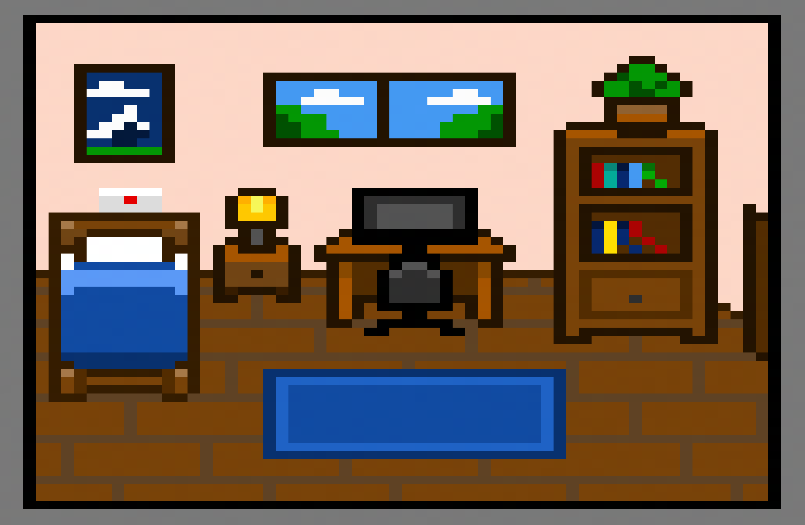

# My-personal-website  
Hii, it's "..."  
  
I made a room which you can click around and find about me. it's a portfolio.  

This page is basically a pixel room which you can click some objects and it will show a popup. That will say abt me. I want it to be creative.
  
## About me
  
 This is acutally my first project which i finished. you will learn about about me in the website.
## About this project
  
 This project only contains html and css. no js is added  

 I drew the pixel room in Piskel
  
 when you hover over some objects it will show a white box around it which indicates that is clickable. when u click the objects It will show a popup which includes things about me. But not every clickable objects has information abt me. check that out!  
  
## Features of the website

 when you  click the shelf it will show about my projects that I'm working on.  

 when you click the computer, it will show a short description of me.  

 There is a mail above the bed. when u click it, a popup shows my email which you can email me if u ever want to.  

 The above three are the main. If you don't want to click the object for some reason then you can directly click the button below, it takes u to the same popups.  
 
 There are also other 3 objects to click which is for fun. Try it out   
  
 The 3 objects are lamp, carpet and a bed.  
## Things that helped me to do this projects  
 I watched a lot of Youtube videos   

 I used piskel to draw the room  
   
 (w3schools html) this website.  
 ## about the image
 I realized the picture is not in the correct ratio after drawing the room so I used paint to stretch the image  
 ## No Ai is used in this project
