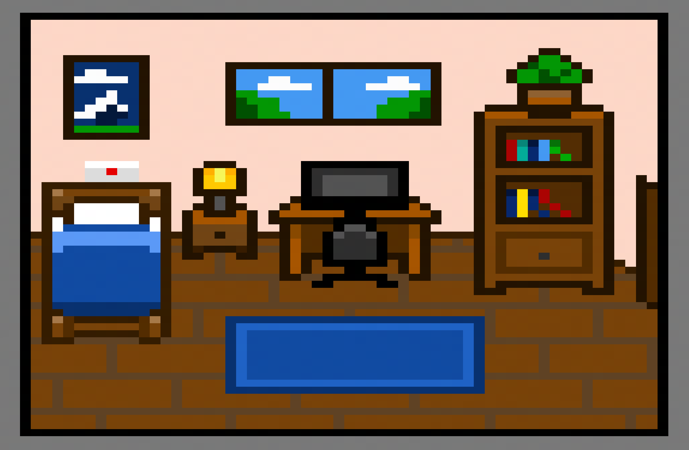

<h1>My-personal-website</h1>
My room. Instead of a boring page, the homepage is a tiny pixel-art bedroom. Click around to find out more about me.
 
Hii, welcome to my personal website! This is my first ever website, built with just HTML and CSS, no JavaScript. I learned most of it from YouTube and a lot of trial and error, so a few pixels might be slightly crooked. Made late at night, be nice to it.
 
<h2>Table of contents</h2>

What is this? 
How to use the site 
How it works 
Project structure 
Customizing it 
Design notes 
Things I learned 
AI use 
Credits 
 

<h2>What is this?</h2> 
A personal portfolio, but instead of a menu and a list of links, you land in my room. Every object is a link to a different part of the site. The page is a little interactive game of "touch something and see what happens."

The site has three sections:
<h3>Object	Opens	What's inside</h3>
Computer: About me,	Who I am, what I like. 
Bookshelf:	My projects	What I'm building right now. 
 mail:	Contact	A way to reach me. 
if you prefer another way, There are also three buttons under the room (projects, about, contact) that do the same thing.

<h2>How to use the site</h2>
Open the page and look around the room.
Hover over an object. A dashed outline shows that it's clickable.
Click it. A popup appears with a short message and the page content.
Click the x in the corner of the popup to close it and go back to the room.
 
<h2>How it works</h2>
There's no JavaScript here. The popups are powered by a CSS trick called the radio button hack:
 
Four hidden radio buttons (none, about, projects, contact) share the same name="page", so only one can be selected at a time.
The clickable areas on the room image are <label> elements pointing at those radio buttons with for="...". Clicking a label selects its radio button.
CSS checks which radio button is selected using :checked and the ~ sibling selector, and shows the matching popup:
   
#about:checked ~ #about-page {
    display: block;
}
   
The x button is a label for the none radio button, which closes whatever popup is open.
The hotspots are invisible boxes placed over the image with position: absolute and percentage values (left, top, width, height), so they stay lined up with the objects even when the image scales.
 
<h3>Project structure</h3>
  
<h4>My-personal-website</h4>

├── index.html           # the page: room image, hotspots, popups, buttons 
├── only.css             # all of the styling 
├── final-room.png       # the pixel-art room (drawn in Piskel) 
├── background-img-2.png # the teal and purple checkerboard background 

 
<h2>Want to make your own room? Here's where to look:</h2>
 
Colors: all the colors live in the :root block at the top of only.css (--cream, --purple, --teal, --light, --dark-teal, --red). Change them once and they update everywhere. 
Hotspot positions: the classes .shelf, .computer, and .lamp (it's the mail acutally) in only.css control where each clickable area sits. Adjust left, top, width, and height until they cover your object.  
The room image: swap final-room.png for your own drawing. You'll need to re-adjust the hotspot positions. 
Background: replace background-img-2.png or change background-size in the body rule. 
  
<h3>Design notes</h3>
   
Palette:  (#feb0a3)
            (#47425e)
           (#01b9be)
          (#ffefcc)
           (#14788d)
           (#fe6973). Warm accents against a cool checkerboard.
   
Pixel-art rendering: image-rendering: pixelated keeps the edges crisp when the image is scaled up instead of getting blurry.
   
Pixel-style borders: the room frame and buttons use stacked box-shadow layers with no blur to imitate a chunky pixel border.
   
Button hover: the buttons grow slightly (transform: scale(1.1)) with a half-second transition.
   
<h3>Things I learned</h3>
How HTML and CSS works, and how to link a stylesheet.   
Positioning things on top of other things with position: relative and absolute.   
Using percentages so layouts scale.   
That you can make interactive stuff without JavaScript.   
Pixel art takes forever, but it's worth it.   
Naming things clearly would have saved me a lot of confusion.   

<h3>AI use</h3>
 
I used AI to help with wording some of the site text and to give me an idea of what I should put there. After that I used my own creativity. The code, the layout, and all the pixel art are mine.

<h3>Credits</h3>
 
Pixel art: drawn by me in Piskel.

btw, The image is stretched. I used paint to stretch it 
Learning resources: YouTube tutorials, plus a lot of trial and error. 
<b>Thank you for visiting my room. See ya!</b>
